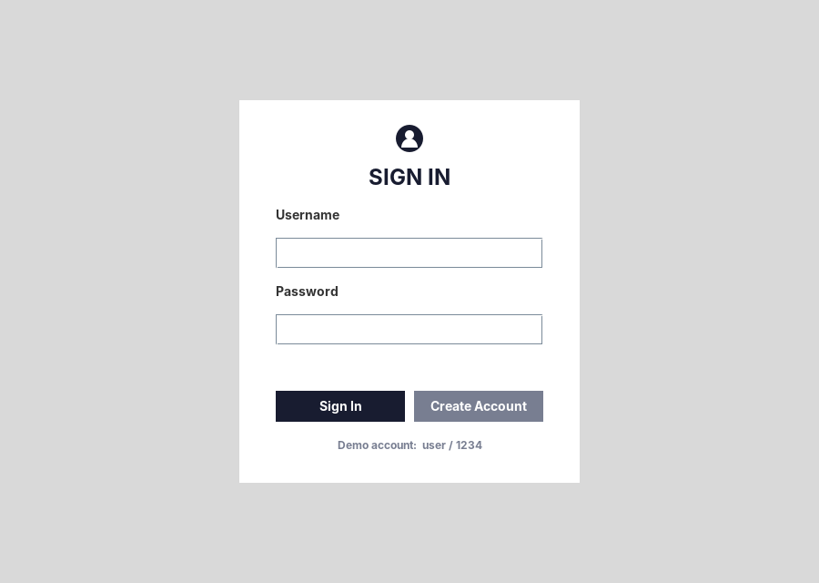
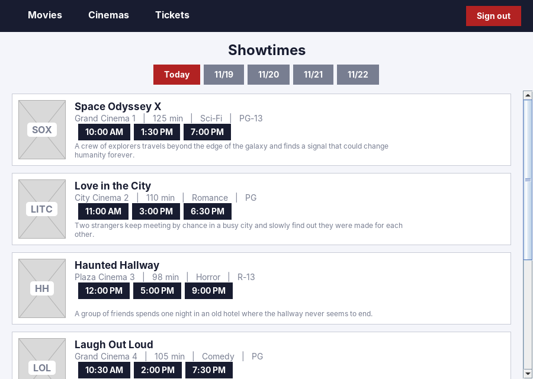
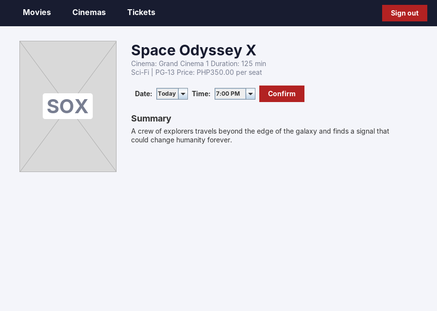
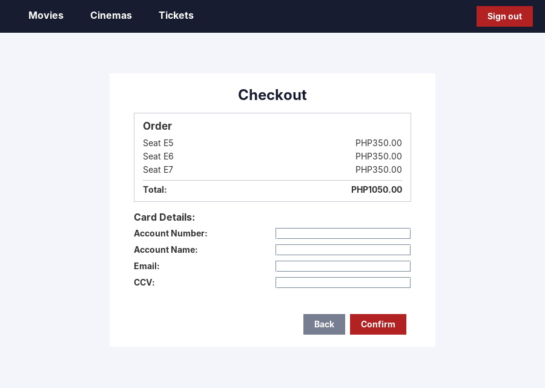
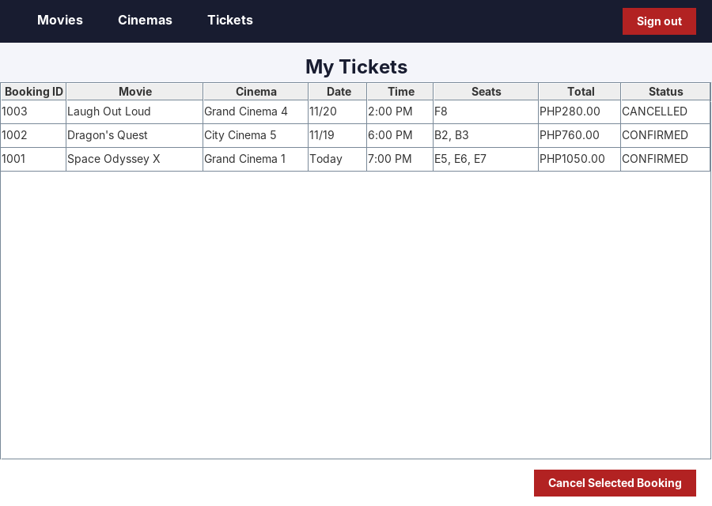
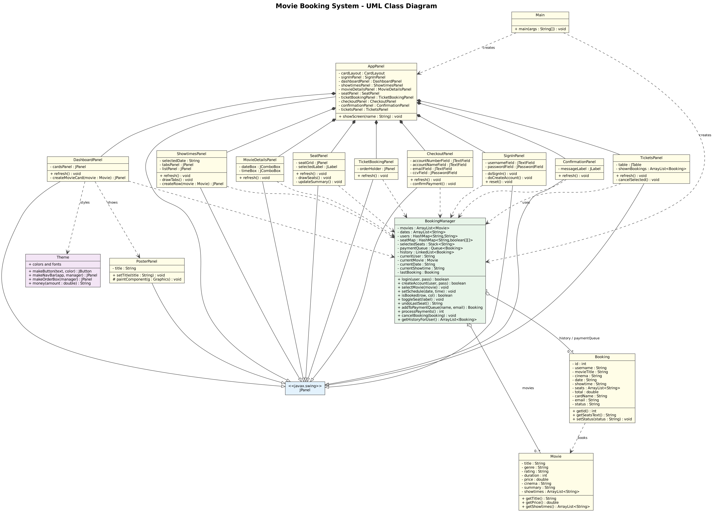

# Movie Booking System

## Description

A desktop Movie Ticket Booking System written in **Java (Swing)**, based on our Figma design. A user signs in (or creates an account), browses the new releases, checks the showtimes by date, picks a seat, reviews the order, pays with card details, and receives an order confirmation. Tickets can be viewed or cancelled later.

## Team Members

| Name | Role |
|---|---|
| Member 1 | Kai Rubillar - (Project Leader / Main Programmer)
| Member 2 | Ayen Celestine Pampliega - (GUI / Panels) 
| Member 3 | Angel Bless Untal - (UML / Logic) 

## How to Run the Project

### Requirements

- **Java JDK 11 or higher** (check with `java -version` and `javac -version`)

### Option: Eclipse (recommended)

The repository already includes the Eclipse project files (`.project` and `.classpath`).

1. Download or clone the repository. If you downloaded a ZIP, extract it first.
2. In Eclipse, go to **File > Import... > General > Existing Projects into Workspace** and click **Next**.
3. Click **Browse...** next to *Select root directory* and choose the `MovieBookingSystem` folder.
4. Make sure the project is ticked, then click **Finish**.
5. Open `src/Main.java` (the files are in the default package, so Eclipse may show a harmless "default package" warning).
6. Right-click `Main.java` and choose **Run As > Java Application**.

If Eclipse shows a red error about the JRE, right-click the project, choose **Build Path > Configure Build Path... > Libraries**, and select any installed JDK (11 or higher).

## INSTRUCTIONS

### Sign in

| Username | Password |
|---|---|
| `user` | `1234` |
| `admin` | `admin123` |

You can also type a new username and password and click **Create Account**.

### How to use

1. Sign in.
2. On the Dashboard, click **View Movie** (or use **Select Date** / **Cinemas** to open the Showtimes page and click a time).
3. On the Movie page, choose the date and time, then click **Confirm**.
4. Click the seats you want. Use **Undo Last Seat** to remove the newest pick. Click **Confirm**.
5. Check the order on the Ticket Booking page and click **Confirm**.
6. On the Checkout page, type the card details (account number: 12 to 16 digits, CCV: 3 digits, a valid email) and click **Confirm**.
7. Read the Order Confirmation and click **Done**.
8. Click **Tickets** in the top bar to see your bookings. Select a row and click **Cancel Selected Booking** to cancel it.

## Screenshots

| Screen | Image |
|---|---|
| Sign In Page |  |
| Dashboard |  |
| Showtimes |  |
| Movie Details |  |
| Movie Seats |  |
| Ticket Booking |  |
| Checkout |  |
| Order Confirmation |  |
| My Tickets |  |

## UML Diagram

Class diagram: [`uml/ClassDiagram.png`](uml/ClassDiagram.png) (also available as [PDF](uml/ClassDiagram.pdf))

