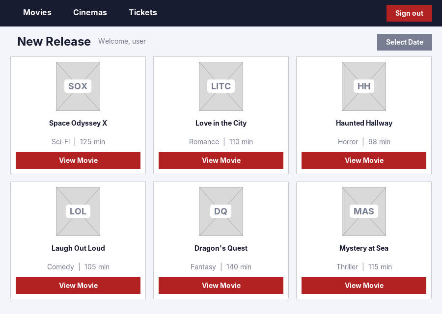
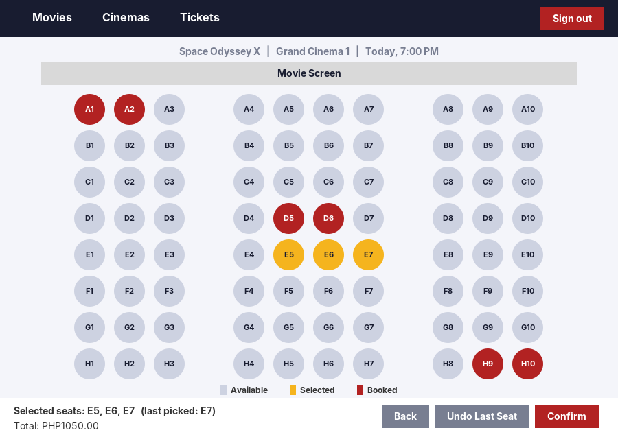
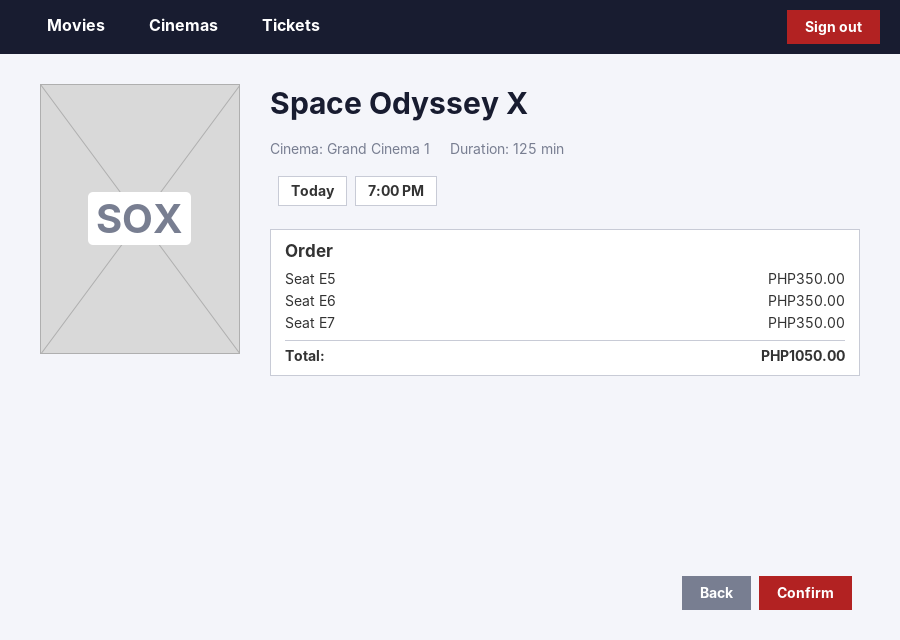
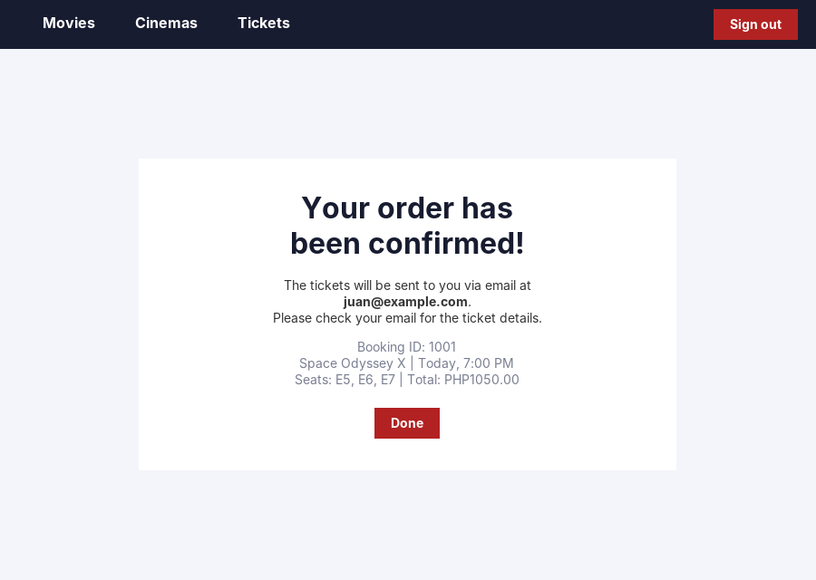

# Movie Booking System

## Description

A desktop Movie Ticket Booking System written in **Java (Swing)**, based on our Figma design. A user signs in (or creates an account), browses the new releases, checks the showtimes by date, picks a seat, reviews the order, pays with card details, and receives an order confirmation. Tickets can be viewed or cancelled later.

The code is kept simple and beginner-friendly, and it shows how common data structures are used in a real program:

| Data structure | Where it is used | Why |
|---|---|---|
| `ArrayList` | List of movies, dates, showtimes of a movie, seats of a booking | Simple, ordered list that is easy to loop through |
| `Stack` | Seats the user picks (`BookingManager.selectedSeats`) | "Undo Last Seat" removes the most recently picked seat (last in, first out) |
| `Queue` (`LinkedList`) | Payment queue (`BookingManager.paymentQueue`) | Bookings are processed in the order they were made (first in, first out) |
| `LinkedList` | Ticket history (`BookingManager.history`) | The newest booking is added to the front with `addFirst` |
| `HashMap` | Usernames and passwords, seat map of each movie/date/time | Fast lookup by a key |

## Features

- Sign in and **Create Account**
- Dashboard with the **New Release** movies
- **Showtimes** page with date tabs (Today and the next 4 days), cinema location and time buttons
- Movie page with details, date and time dropdowns, and summary
- **Movie Seats** page (8 rows x 10 seats): grey = available, gold = selected, red = booked
- Undo last seat (Stack) and live total price
- **Ticket Booking** page with the order (seats and prices)
- **Checkout** with card details (account number, account name, email, CCV) and input checks
- **Order Confirmation** page
- **Tickets** page: booking history (newest first) and booking cancellation (seats become free again)

## Team Members

> Replace the names and roles below with your own group members.

| Name | Role |
|---|---|
| Member 1 | Project Leader / Main Programmer |
| Member 2 | Programmer (GUI / Panels) |
| Member 3 | Programmer (Data Structures / Logic) |
| Member 4 | Documentation, UML and Testing |

## How to Run the Project

### Requirements

- **Java JDK 11 or higher** (check with `java -version` and `javac -version`)

### Option 1: Command line

Open a terminal inside the project folder, then:

```bash
# 1. Compile all the files (the compiled files go to a folder named "out")
javac -d out src/*.java

# 2. Run the program
java -cp out Main
```

On Windows Command Prompt, use `javac -d out src\*.java` for step 1.

### Option 2: Eclipse (recommended)

The repository already includes the Eclipse project files (`.project` and `.classpath`).

1. Download or clone the repository. If you downloaded a ZIP, extract it first.
2. In Eclipse, go to **File > Import... > General > Existing Projects into Workspace** and click **Next**.
3. Click **Browse...** next to *Select root directory* and choose the `MovieBookingSystem` folder.
4. Make sure the project is ticked, then click **Finish**.
5. Open `src/Main.java` (the files are in the default package, so Eclipse may show a harmless "default package" warning).
6. Right-click `Main.java` and choose **Run As > Java Application**.

If Eclipse shows a red error about the JRE, right-click the project, choose **Build Path > Configure Build Path... > Libraries**, and select any installed JDK (11 or higher).

### Option 3: Other IDEs (IntelliJ IDEA, NetBeans, VS Code)

Open or import the project folder, mark `src` as the source folder, open `src/Main.java`, and click **Run**.

### Sign in

| Username | Password |
|---|---|
| `user` | `1234` |
| `admin` | `admin123` |

You can also type a new username and password and click **Create Account**.

### How to use

1. Sign in.
2. On the Dashboard, click **View Movie** (or use **Select Date** / **Cinemas** to open the Showtimes page and click a time).
3. On the Movie page, choose the date and time, then click **Confirm**.
4. Click the seats you want. Use **Undo Last Seat** to remove the newest pick. Click **Confirm**.
5. Check the order on the Ticket Booking page and click **Confirm**.
6. On the Checkout page, type the card details (account number: 12 to 16 digits, CCV: 3 digits, a valid email) and click **Confirm**.
7. Read the Order Confirmation and click **Done**.
8. Click **Tickets** in the top bar to see your bookings. Select a row and click **Cancel Selected Booking** to cancel it.

## Project Structure

```
MovieBookingSystem/
├── src/
│   ├── Main.java                Starts the program
│   ├── AppPanel.java            Switches between the screens (CardLayout)
│   ├── SignInPanel.java         Sign In page
│   ├── DashboardPanel.java      Dashboard (New Release)
│   ├── ShowtimesPanel.java      Showtimes
│   ├── MovieDetailsPanel.java   Movie details
│   ├── SeatPanel.java           Movie Seats
│   ├── TicketBookingPanel.java  Ticket Booking
│   ├── CheckoutPanel.java       Checkout
│   ├── ConfirmationPanel.java   Order Confirmation
│   ├── TicketsPanel.java        Tickets (booking history)
│   ├── BookingManager.java      All data structures and booking logic
│   ├── Movie.java               Movie data
│   ├── Booking.java             Booking data
│   ├── PosterPanel.java         Grey poster placeholder
│   ├── Theme.java               Colors, fonts, navigation bar and helpers
│   └── ScreenshotGenerator.java Optional: saves the screenshots
├── screenshots/                 Screenshot of every screen
├── uml/                         UML class diagram (PNG, PDF and source)
└── README.md
```

## Screenshots

| Screen | Image |
|---|---|
| Sign In Page |  |
| Dashboard |  |
| Showtimes |  |
| Movie Details |  |
| Movie Seats |  |
| Ticket Booking |  |
| Checkout |  |
| Order Confirmation |  |
| My Tickets |  |

## UML Diagram

Class diagram: [`uml/ClassDiagram.png`](uml/ClassDiagram.png) (also available as [PDF](uml/ClassDiagram.pdf))


